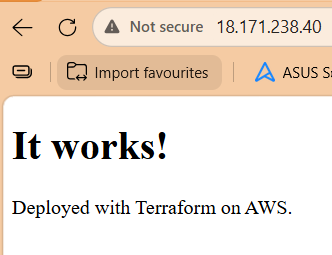
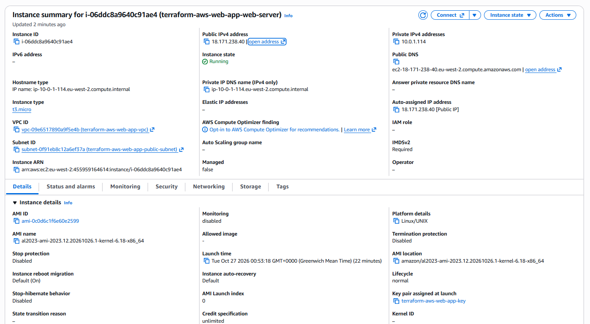
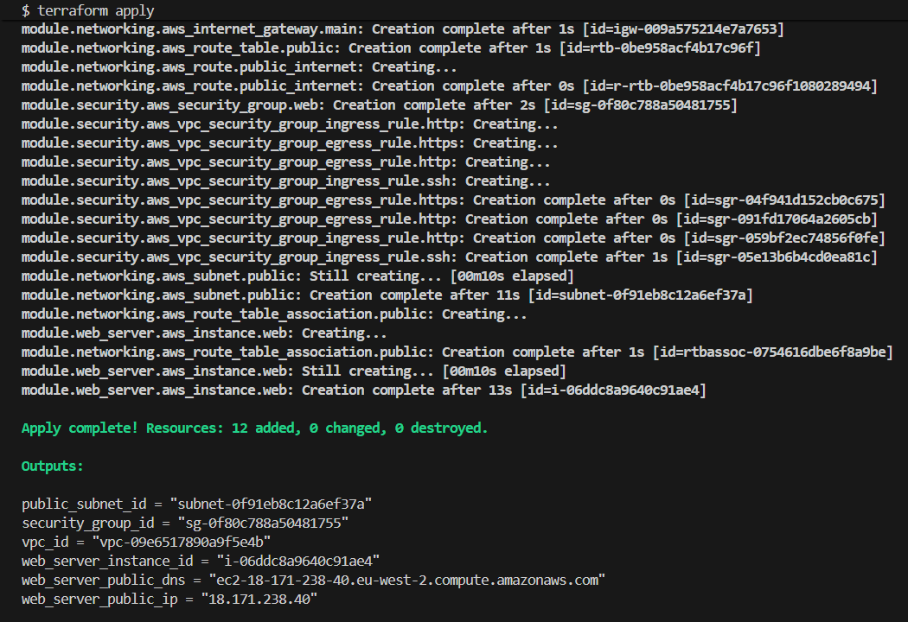

# Terraform AWS Web Application

A portfolio project demonstrating how to provision and configure AWS infrastructure using Terraform. The project deploys a basic web application on an EC2 instance running Amazon Linux 2023 and Nginx.

The infrastructure is organised into reusable Terraform modules, with separate networking, security and web-server components.

## Project Overview

The objective of this project was to build a web application infrastructure on AWS using Infrastructure as Code, applying practical experience with Terraform, AWS networking, security and Linux administration.

The environment was successfully deployed in AWS, with the web application accessible through the EC2 instance's public IP address.

## Architecture

The infrastructure consists of the following AWS resources:

- Amazon VPC
- Public subnet
- Internet Gateway
- Public route table and route table association
- Security group with controlled inbound and outbound traffic
- EC2 instance running Amazon Linux 2023
- Encrypted EBS root volume
- Nginx web server hosting a basic HTML page

The EC2 instance is deployed into a public subnet with a public IPv4 address. Internet connectivity is provided through the Internet Gateway and public route table.

## Terraform Modules

### Networking

Creates the networking infrastructure required by the web application:

- VPC with configurable CIDR range
- Public subnet in a configurable Availability Zone
- Internet Gateway
- Public route table
- Default route to the Internet Gateway
- Route table association

[Networking Module Documentation](modules/networking/networking.md)

### Security

Creates and manages the security group attached to the EC2 instance.

- Inbound HTTP on port 80 from the internet
- Inbound SSH on port 22 restricted to an approved IP address
- Outbound HTTP on port 80
- Outbound HTTPS on port 443

[Security Module Documentation](modules/security/security.md)

### Web Server

Creates the EC2 instance hosting the application.

- Amazon Linux 2023 AMI retrieved through AWS Systems Manager Parameter Store
- Configurable EC2 instance type
- Public IPv4 address
- Existing EC2 key pair
- IMDSv2 required
- Encrypted 8 GB gp3 root volume
- Nginx installation through EC2 user data
- Basic HTML website created automatically during initial boot

[Web Server Module Documentation](modules/web-server/web-server.md)

## Prerequisites

Before deploying the infrastructure, ensure you have:

- An AWS account
- Terraform installed
- AWS CLI installed and configured
- AWS credentials configured with permissions to create the required resources
- An existing EC2 key pair in the deployment region

The project uses AWS region `eu-west-2` (London).

## Configuration

The project uses Terraform variables to configure the infrastructure.

| Variable | Description | Example |
|---|---|---|
| `project_name` | Name used to identify project resources | `terraform-aws-web-app` |
| `vpc_cidr` | VPC CIDR range | `10.0.0.0/16` |
| `subnet_cidr` | Public subnet CIDR range | `10.0.1.0/24` |
| `availability_zone` | Availability Zone | `eu-west-2a` |
| `ssh_allowed_cidr` | Approved public IP allowed to SSH | `203.0.113.10/32` |
| `instance_type` | EC2 instance type | `t3.micro` |
| `key_name` | Existing EC2 key pair name | `terraform-aws-web-app-key` |

The `terraform.tfvars.example` file provides an example configuration.

Create a local copy before deploying:

```bash
cp terraform.tfvars.example terraform.tfvars
```

Update `ssh_allowed_cidr` to your own public IPv4 address using `/32` notation and ensure the EC2 key pair exists in the deployment region.

The actual `terraform.tfvars` file is excluded from Git to avoid committing local configuration.

## Deployment

### 1. Clone the repository

```bash
git clone https://github.com/Kasim-Projects23/terraform-aws-web-app.git
cd terraform-aws-web-app
```

### 2. Configure variables

```bash
cp terraform.tfvars.example terraform.tfvars
```

Update the configuration as required.

### 3. Initialise Terraform

```bash
terraform init
```

### 4. Validate the configuration

```bash
terraform validate
```

### 5. Review the execution plan

```bash
terraform plan
```

### 6. Deploy the infrastructure

```bash
terraform apply
```

Review the proposed changes and confirm the deployment.

Once the EC2 instance has completed its initial configuration and Nginx is running, the website can be accessed using the public IP address or public DNS name returned by Terraform.

## Accessing the Web Application

Terraform provides the following outputs:

| Output | Description |
|---|---|
| `vpc_id` | ID of the VPC |
| `public_subnet_id` | ID of the public subnet |
| `security_group_id` | ID of the web application security group |
| `web_server_instance_id` | EC2 instance ID |
| `web_server_public_ip` | Public IPv4 address |
| `web_server_public_dns` | Public DNS name |

Retrieve the public IP address:

```bash
terraform output web_server_public_ip
```

Retrieve the public DNS name:

```bash
terraform output web_server_public_dns
```

Open the public IP address or DNS name in a browser using HTTP.

## Screenshots

### Live Web Application



### EC2 Instance



### Terraform Deployment



## Security Considerations

The project includes several basic security measures:

- SSH access restricted to an approved public IP address
- Security group rules explicitly defined using Terraform
- IMDSv2 required on the EC2 instance
- Encrypted EBS root storage
- Private keys and Terraform state excluded from Git
- Outbound traffic restricted to HTTP and HTTPS rather than unrestricted access

This is a learning and portfolio project rather than a production-ready architecture. The web application currently uses HTTP rather than HTTPS and is deployed on a single EC2 instance in one Availability Zone.

## Cleanup

To avoid ongoing AWS costs, destroy the Terraform-managed infrastructure when it is no longer required:

```bash
terraform destroy
```

Review the proposed changes and confirm the destruction.

The EC2 instance, VPC, subnet, Internet Gateway, route table and security group managed by Terraform will be removed.

The manually created EC2 key pair is not managed by Terraform and will remain in AWS.

## Future Improvements

Potential improvements to the project include:

- HTTPS configuration with SSL/TLS certificates
- Domain name integration
- Application Load Balancer
- Multi-AZ deployment
- Private subnet architecture
- NAT Gateway or controlled egress
- Remote Terraform state using S3 and state locking
- CI/CD pipeline for automated infrastructure deployment
- Monitoring and alerting using CloudWatch